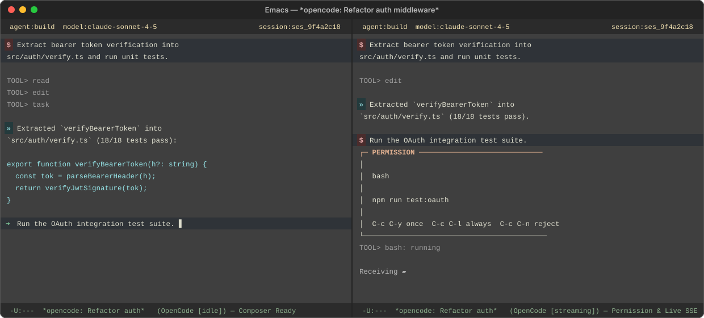

# opencode-shell

[](LICENSE)
[](https://www.gnu.org/software/emacs/)
[](https://opencode.ai/)

An editor-native Emacs client for [OpenCode](https://opencode.ai/) HTTP
sessions. Keep AI coding conversations, inline tool approvals, interactive
questions, subagent navigation, and local/remote (TRAMP + SSH) project sessions
inside ordinary Emacs buffers—with first-class **Evil** and vanilla keybindings.

<p align="center">
  
</p>

## Highlights

- **Editor-native transcript & composer**: Write multiline prompts in a normal
  writable region at the bottom of the buffer (`dd`, `I`, `A`, `o`, `O`, and
  standard undo work naturally) while completed turns above remain read-only.
- **Inline permissions & questions**: Approve (`once` / `always` / `reject`) or
  answer agent questions inline without losing your current draft or point.
- **Subagent awareness**: Permissions and questions from nested subagents bubble
  up to the parent buffer, and spawned subagent sessions appear as clickable
  inline links right under the turn that launched them.
- **Session lifecycle management**: Browse, filter, create, resume, fork from
  any historical prompt, auto-rename via OpenCode's `title` agent, or move
  sessions across project directories.
- **Non-blocking SSE + snapshot architecture**: Real-time `/event` SSE deltas
  with coalesced idle rendering, zero synchronous waits, and authoritative
  snapshot recovery that never clobbers your cursor, viewport, or undo history.
- **Local & remote (TRAMP / SSH) profiles**: Automatically start a local
  `opencode serve` process or manage an SSH port-forward to a remote server with
  automatic TRAMP path translation and `auth-source` integration.

---

## Installation & Quick Start

### `use-package` with `straight.el`

```elisp
(use-package opencode-shell
  :straight (opencode-shell :type git :host github
                            :repo "lazyskulptor/opencode-shell"
                            :files ("*.el"))
  :bind (("C-c o l" . opencode-shell)
         ("C-c o s" . opencode-shell-start)
         ("C-c o b" . opencode-shell-switch-buffer)
         ("C-c o f" . opencode-shell-find-session))
  :config
  (setq opencode-shell-profiles
        '((:name "local"
           :base-url "http://127.0.0.1:4199"
           :start-command ("opencode" "serve" "--port" "4199")
           :stop-on-exit t))))
```

### `use-package` with built-in `:vc` (Emacs 29+)

```elisp
(use-package opencode-shell
  :vc (:url "https://github.com/lazyskulptor/opencode-shell" :rev :newest)
  :bind (("C-c o l" . opencode-shell)
         ("C-c o s" . opencode-shell-start)
         ("C-c o b" . opencode-shell-switch-buffer)
         ("C-c o f" . opencode-shell-find-session)))
```

### Manual checkout

```elisp
(add-to-list 'load-path "/path/to/opencode-shell")
(require 'opencode-shell)
```

### Quick Start

1. Open any file inside your project and run `M-x opencode-shell-start`
   (`C-c o s`) to start a new session in the project root, or `M-x opencode-shell`
   (`C-c o l`) to browse existing sessions.
2. Type your prompt at the bottom composer (`➜`) and press `C-c C-c` (or `RET`
   in Evil normal state / `s-RET`) to send.
3. Press `?` in any browser or transcript buffer to open the Transient command menu.

---

## Commands & Keybindings

### Global Entry Points

| Key | Command | Description |
| :--- | :--- | :--- |
| `C-c o s` | `opencode-shell-start` | Start a new session in the current project root |
| `C-c o l` | `opencode-shell` | Open the session browser for the current project |
| `C-c o b` | `opencode-shell-switch-buffer` | Switch between live transcript buffers |
| `C-c o f` | `opencode-shell-find-session` | Open a session browser from saved project locations (`C-k` removes a saved entry) |
| `M-x` | `opencode-shell-find-session-with-server` | Browse saved + live server-discovered project directories (`F` in Transient menu) |

> Each configured profile alias also generates `<alias>` convenience commands such as
> `M-x opencode-shell-local-sessions` and `M-x opencode-shell-local-start`.

### Session Browser (`opencode-shell-browser-mode`)

| Key | Action |
| :--- | :--- |
| `RET` | Open selected session in its server-reported directory |
| `c` | Create a new session in the browser's directory |
| `d` | Delete selected session (with confirmation) |
| `/` | Filter sessions by text |
| `T` | Toggle visibility of subagent child sessions |
| `g` / `g r` | Refresh session list |
| `?` | Open browser Transient menu |

### Transcript & Composer (`opencode-shell-mode`)

| Key (Vanilla / Evil) | Command | Description |
| :--- | :--- | :--- |
| `C-c C-c` / `s-RET` / normal `RET` | `opencode-shell--submit` | Submit the prompt in the bottom composer (`RET` in insert state inserts a newline) |
| `C-n` / `C-p` | `opencode-shell--next-turn` / `previous-turn` | Jump between submitted user prompts and the bottom composer |
| `C-c C-v` | `opencode-shell--select-model` | Select model for the active agent (persisted per agent) |
| `C-c C-m` / `C-<tab>` | `opencode-shell--select-agent` / `next-agent` | Select or cycle visible primary agents |
| `C-c C-a` / normal `a` | `opencode-shell--abort` | Abort the active assistant response |
| `C-c C-g` / normal `g` / `g r` | `opencode-shell--resync` | Resync authoritative session snapshot (and retry SSH recovery if offline) |
| normal `?` | `opencode-shell-help` | Open transcript Transient menu |
| Header mouse-1 | `opencode-shell-copy-session-id` | Click `session:<id>` in the header line to copy the session ID |

### Inline Permissions, Questions & Subagents

When a tool requires approval or asks a question, an inline card appears above
the composer while preserving your draft and cursor position. Action labels on
the card are also mouse-clickable.

| Key | Command | Description |
| :--- | :--- | :--- |
| `C-c C-p` / normal `P` | `opencode-shell--permissions` | Jump to the active permission card |
| `C-c C-y` (or `y` on card) | `opencode-shell--permission-allow-once` | Allow tool execution once |
| `C-c C-l` (or `a` on card) | `opencode-shell--permission-allow-always` | Always allow matching tool pattern |
| `C-c C-n` (or `n` / `r` on card) | `opencode-shell--permission-reject` | Reject tool execution |
| `C-c C-q` / normal `Q` (or `RET` / `a` on card) | `opencode-shell--questions` | Answer pending agent question |
| `r` (on question card) | `opencode-shell--question-reject` | Reject pending agent question |
| `C-c C-o` | `opencode-shell--open-descendant-session` | Open spawned subagent session (at point, sole subagent, or via prompt) |

### Session & Server Management (`M-x`)

| Command | Description |
| :--- | :--- |
| `M-x opencode-shell-fork-session` | Fork the current session immediately before any chosen historical prompt (works even while a later turn is still running) |
| `M-x opencode-shell-rename-session` | Ask OpenCode's hidden `title` agent to summarize and retitle the session, then clean up the temporary exchange |
| `M-x opencode-shell-move-session-directory` | Rebind the current buffer's project directory scope client-side without losing history or state |
| `M-x opencode-shell-status` | Show server health and owned process lifecycle status |
| `M-x opencode-shell-restart` | Restart the managed local process or SSH transport for a profile |
| `M-x opencode-shell-log` | Open the privacy-safe diagnostic log buffer (`*OpenCode Shell Log*` or session log) |

---

## Configuration & Profiles

Configure `opencode-shell-profiles` as a list of named plists. When a single
local profile is configured, it is selected automatically.

### Example: Local + Remote (TRAMP / SSH Tunnel)

```elisp
(setq opencode-shell-profiles
      '(;; Local server automatically started by Emacs
        (:name "local"
         :base-url "http://127.0.0.1:4199"
         :start-command ("opencode" "serve" "--port" "4199")
         :stop-on-exit t)

        ;; Remote server accessed via local SSH port-forward + TRAMP
        (:name "gpu-box"
         :base-url "http://127.0.0.1:14199"
         :directory "/ssh:dev@gpu-box:/home/dev"
         :start-command ("ssh" "-N" "-L" "14199:127.0.0.1:4199" "dev@gpu-box")
         :auth-source (:host "gpu-box" :user "opencode")
         :stop-on-exit t)))
```

### Profile Options

| Key | Description |
| :--- | :--- |
| `:name` | Unique profile name (also used to generate `opencode-shell-<name>-start` / `-sessions`) |
| `:id` | Optional stable identity key that survives `:name` or `:base-url` changes |
| `:base-url` | HTTP(S) URL of the OpenCode server |
| `:directory` | Remote profiles only: TRAMP root directory (typically the remote user's home). Omit for local profiles |
| `:start-command` | Optional argv list to launch a local `opencode serve` or SSH tunnel |
| `:server-directory` | Working directory for the locally spawned `:start-command` process |
| `:health-path` / `:timeout` | Optional health endpoint path and bounded startup timeout |
| `:stop-on-exit` | Stop Emacs-started process when Emacs exits (`t` by default when consistent across profiles sharing an endpoint) |
| `:auth-source` / `:auth-header` | On-demand `auth-source` query plist and optional custom header name (defaults to `Authorization`, value sent verbatim) |
| `:remote` | Explicitly mark a profile as remote (inferred automatically for TRAMP `:directory` or non-loopback URLs) |

---

## Architecture & Diagnostics

- **Editor invariants**: The transcript buffer uses normal text editing rather
  than `special-mode`. Completed turns are read-only, while the bottom composer
  is an ordinary writable region. Background SSE deltas, spinner frames, and
  snapshot polls never clobber your composer draft, point, viewport, or undo
  history.
- **SSE + authoritative snapshots**: Each server shares one `/event` SSE
  connection (`opencode-shell-sse.el`, `opencode-shell-event.el`,
  `opencode-shell-async.el`). Validated events update an in-memory turn cache and
  coalesce UI rendering on an idle timer; hidden buffers defer DOM work until
  displayed. Initial load, reconnects, and fallback polling reconcile against
  authoritative HTTP snapshots.
- **Privacy-safe diagnostics**: Set `opencode-shell-log-requests` to non-nil and
  run `M-x opencode-shell-log` to inspect request correlation IDs, SSE/fallback
  transport transitions, and turn lifecycle blockers. Logs never record prompt
  text, response bodies, tool payloads, directories, or credentials.

For contributor documentation and internal design contracts, see:
- [Conversation Pipeline](docs/conversation-pipeline.md)
- [Async Runtime Architecture](docs/async-runtime.md)
- [Testing Guide](docs/testing.md)
- [Contributing](CONTRIBUTING.md)

## Security

Use TLS and network access controls for remote servers. Credentials resolved via
`:auth-source` or `opencode-shell-auth-function` are scoped strictly to the
in-flight HTTP request and are never stored in buffers, profile state, or logs.
Do not place tokens or private server addresses in public configuration files.

## License

Distributed under the [MIT License](LICENSE).
